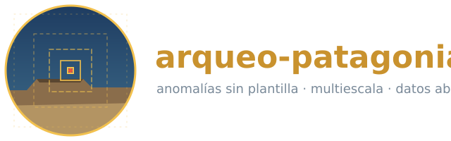

<p align="center">
  
</p>

<p align="center">
  <a href="LICENSE"></a>
  
  <a href="https://claude.com/claude-code"></a>
  
  
</p>

**arqueo-patagonia** es un pipeline de prospección arqueológica remota para la
Patagonia austral (Santa Cruz y Tierra del Fuego, Argentina). Usa solo datos
satelitales abiertos y busca **anomalías sin plantilla**: lugares que se
apartan de su entorno de forma persistente en el tiempo, a varias escalas,
sin suponer de antemano qué forma ni qué tamaño tiene un sitio.

> ⚠️ **Proyecto experimental, hecho por un agente de IA.** Leé
> [Cómo se hizo](#cómo-se-hizo) y [Uso responsable](#uso-responsable) antes de
> usarlo. Un candidato **no es un sitio**: es un lugar que merece que alguien
> con formación arqueológica lo mire.

---

## Principio rector

El objetivo **no** es encontrar sitios parecidos a los ya conocidos. Un
detector construido alrededor de morfologías conocidas solo puede hallar
morfologías conocidas: eso es un sesgo del instrumento. Por eso:

- toda la detección es **no supervisada y multiescala**: ventanas de 50 m,
  150 m, 500 m, 1,5 km y 5 km, y todas corren siempre;
- se buscan píxeles y regiones que **persisten** estadísticamente distintos de
  su entorno local, sin presuponer forma ni tamaño;
- lo que no encaja en ninguna clase conocida se ranquea **primero**
  (bucket `NO_CLASIFICABLE`), no se descarta;
- los sitios publicados sirven solo como **control de cordura**. Está prohibido
  ajustar parámetros para maximizar el recall sobre ellos.

## Cómo funciona

```
 STAC (ventanas COG)      Módulo 1               Módulo 2                     Módulo 3                 Módulo 4
 ───────────────────      ────────               ────────                     ────────                 ────────
 Sentinel-2 L2A  ─┐       prior de               rasgos por fecha             OSM: marca lo            recall@N y lift
 Sentinel-1 RTC  ─┼──►    preservación  ──►      + residuo robusto     ──►    moderno (no borra)  ──►  contra un nulo
 Copernicus DEM  ─┤       (solo ordena           a 5 escalas                  rareza (IForest+MCD)     con el mismo prior
 WorldCover      ─┘       la cola)               + persistencia               3 buckets
                                                 + componentes                clase restringida
```

| módulo | archivos | qué hace |
|---|---|---|
| grilla y estado | `grid.py`, `state.py` | celdas de 10×10 km en UTM sur, tiers T1–T4, barrido de sur a norte; SQLite reanudable y paralelizable |
| datos | `stac.py` | lectura por ventanas de COG: S2 L2A (Earth Search), S1 RTC (Planetary Computer), Copernicus DEM, ESA WorldCover, Hansen GFC |
| 1 · prior | `prior.py`, `escarpments.py` | dónde algo antiguo pudo sobrevivir y seguir visible (proxies glaciales, tefra, sedimentación activa, superficies estables); ranking de paredones para aleros (T4) |
| 2 · detector | `anomaly.py`, `multiscale.py`, `features.py`, `descriptors.py` | residuos contra mediana local robusta a 5 escalas, persistencia binomial en 7 años, componentes separadas por watershed, descriptores geométricos genéricos |
| 3 · triaje | `modern.py`, `triage.py` | infraestructura OSM marcada como histórico-reciente, rareza contra el propio paisaje, buckets |
| 4 · validación | `validate.py` | recall@N, modelo nulo con el mismo prior, lift; números crudos |
| salida | `chips.py`, `export.py`, `satellogic.py`, `corona.py` | fichas multiescala, export sin clase restringida, recortes Satellogic 1 m, CORONA/HEXAGON vía USGS M2M |

## Instalación

```bash
git clone https://github.com/777aeterna/ArgenArqueo.git
cd ArgenArqueo
python3 -m venv .venv && source .venv/bin/activate
pip install -e .
pip install bottleneck pysheds pytest   # recomendados
python -m pytest -q tests
```

Probado en Linux con Python 3.13. Necesita acceso a internet hacia los
catálogos STAC y los buckets públicos de imágenes.

## Uso

```bash
arqueo init-grid                       # registra las celdas de T1..T4
arqueo prior --tier T1 --workers 3     # métricas de preservación -> orden de la cola
arqueo rank                            # muestra la cola; --escarpments para T4
arqueo run --tier T1 --workers 1 --limit 10
arqueo run --cells <cell_id> ...       # celdas puntuales
arqueo status --timings
arqueo triage                          # OSM + rareza + buckets
arqueo validate                        # requiere data/validation/sitios_publicados.csv
arqueo chips --top 50
arqueo export --top 500                # NUNCA incluye la clase restringida
```

Variables de entorno opcionales: `ARQUEO_THREADS` (hilos por worker),
`ARQUEO_OVERPASS` (servidor Overpass), `USGS_M2M_USERNAME` y `USGS_M2M_TOKEN`
(CORONA/HEXAGON).

## Costo

Medido en una celda de 10×10 km con 4 vCPU: **~9–10 min por celda**, ~380
fechas de Sentinel-2 útiles, ~8,6 GB de RAM pico y ~100 MB de productos por
celda. Detalle por etapa y por escala en [docs/COSTOS.md](docs/COSTOS.md).

## Uso responsable

El patrimonio arqueológico argentino está protegido por la **Ley Nacional
25.743** y por normas provinciales. Este proyecto toma estas decisiones de
diseño, y pedimos que quien lo use las respete:

- **Al repositorio va solo código.** `.gitignore` excluye todo producto con
  coordenadas (`data/`, `outputs/`, `*.gpkg`, `*.tif`, `*.csv`). No subas
  resultados a repositorios públicos.
- **Clase restringida.** Los posibles chenques (entierros) se marcan con
  `restricted=True`, quedan en el archivo local, sus fichas van a
  `outputs/chips/RESTRINGIDO/` y **ningún export los incluye**.
- **No es una herramienta de búsqueda de tesoros.** Los candidatos deben ser
  evaluados por profesionales y comunicados a las autoridades de aplicación
  (organismos provinciales de patrimonio, INAPL) antes de cualquier visita.
- **Las ausencias no son evidencia de ausencia.** El bosque de dosel cerrado se
  registra como "no evaluable sin LiDAR" y la franja costera de píxeles mixtos
  como no evaluada: son brechas de cobertura, no zonas sin hallazgos.

## Limitaciones conocidas

- A 10 m de resolución, las estructuras de pocos metros (chenques, parapetos)
  son sub-píxel. Los recortes Satellogic de 1 m son el control, pero su
  cobertura en Patagonia es escasa.
- Límites glaciales, tefra y litología se aproximan con proxies (no hay
  capas abiertas accesibles por ventana); ver la documentación de `prior.py`.
- Las reglas de "morfología descrita en la bibliografía" del triaje son
  etiquetas gruesas, no detectores, y **requieren revisión por especialistas**.
- La validación todavía no se corrió con sitios publicados reales.
- CORONA/HEXAGON (corregistro ORB/SIFT + homografía) no fue probado con
  imágenes reales.

## Cómo se hizo

Este proyecto fue **vibecodeado**: lo escribió de punta a punta **Claude, un
agente de IA de Anthropic, trabajando en [Claude Code](https://claude.com/claude-code)**,
a partir de una especificación escrita por una persona (objetivos, principio
rector, áreas, datos, módulos y reglas de resguardo). El agente diseñó el
código, lo corrió sobre datos reales, midió costos y corrigió los problemas que
aparecieron (por ejemplo, componentes que percolaban en redes de km² y
artefactos de píxeles mixtos en la costa). Los commits llevan la coautoría del
agente.

Qué significa en la práctica:

- **Ningún arqueólogo revisó todavía el código ni los resultados.** Tratalo como
  un prototipo de investigación, no como un instrumento validado.
- Las decisiones metodológicas están documentadas en el código (docstrings de
  cada módulo) para que se puedan auditar y discutir.
- Las contribuciones de especialistas en arqueología, teledetección y
  geomorfología patagónica son especialmente bienvenidas.

## Contribuir

Ver [CONTRIBUTING.md](CONTRIBUTING.md). Las propuestas que optimicen el
detector contra sitios conocidos van en contra del principio rector y no se
aceptan; las que mejoren la estadística, el costo o el resguardo, sí.

## Licencia

[MIT](LICENSE). Los datos satelitales usados tienen sus propias licencias
(Copernicus, ESA WorldCover CC-BY 4.0, Hansen GFC CC-BY 4.0, Satellogic
EarthView CC-BY 4.0, OpenStreetMap ODbL).
